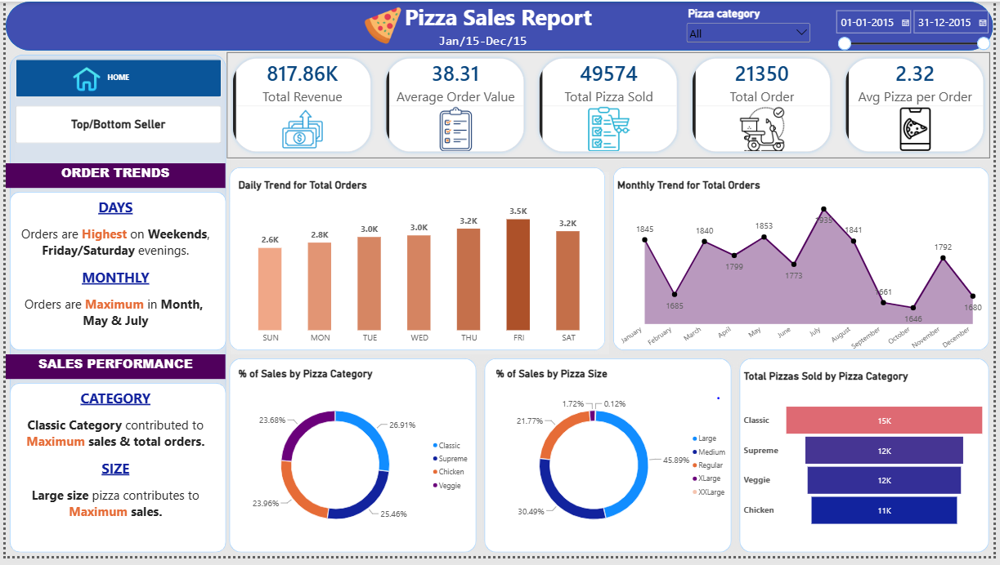

# Pizza Sales Analysis | MySQL & Power BI

## Project Overview

This project analyses pizza sales data using MySQL and Power BI to understand sales performance, customer ordering patterns, and product demand.

The goal is to calculate key business metrics, identify sales trends, and present useful insights through an interactive dashboard.

## Tools and Technologies

- **MySQL** – Data analysis, aggregation, filtering, grouping, and date-based analysis
- **Microsoft Power BI** – Dashboard creation and data visualization
- **DAX** – KPI calculations and measures
- **Microsoft Excel** – Data organization and analysis, where applicable

## Key Performance Indicators (KPIs)

- Total Revenue
- Total Orders
- Total Pizzas Sold
- Average Order Value (AOV)
- Average Pizzas per Order

## Analysis Performed

- Analysed daily and monthly order trends.
- Compared sales performance by pizza category and size.
- Identified the top- and bottom-performing pizzas.
- Used SQL aggregate functions, GROUP BY, sorting, and date functions.
- Created Power BI KPI cards and charts to present sales performance.
- Validated key Power BI calculations against SQL results.

## Dashboard Preview

## Key Learnings

- Practised SQL queries for business data analysis.
- Created KPI measures using DAX.
- Built an interactive Power BI dashboard.
- Used charts and visualizations to communicate business insights.
- Cross-checked calculations to improve data accuracy.

## Project Files

- `Pizza_Sales_Analysis.sql` – SQL queries used for the analysis
- `Pizza_Sales_Analysis.pbix` – Power BI dashboard file
- `Pizza_Sales_Dashboard.PNG` – Dashboard screenshot
- `README.md` – Project documentation

## Conclusion

This project demonstrates my ability to analyse sales data using SQL, calculate business KPIs, and present findings through Power BI visualizations.
